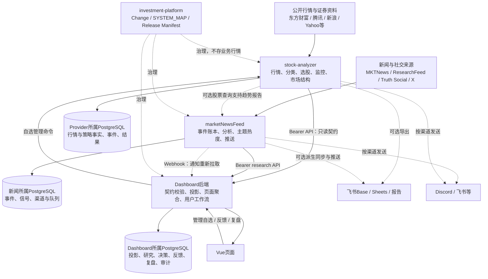
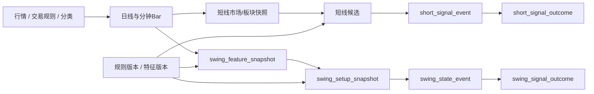
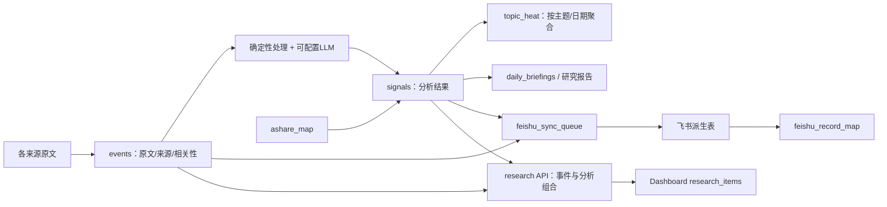
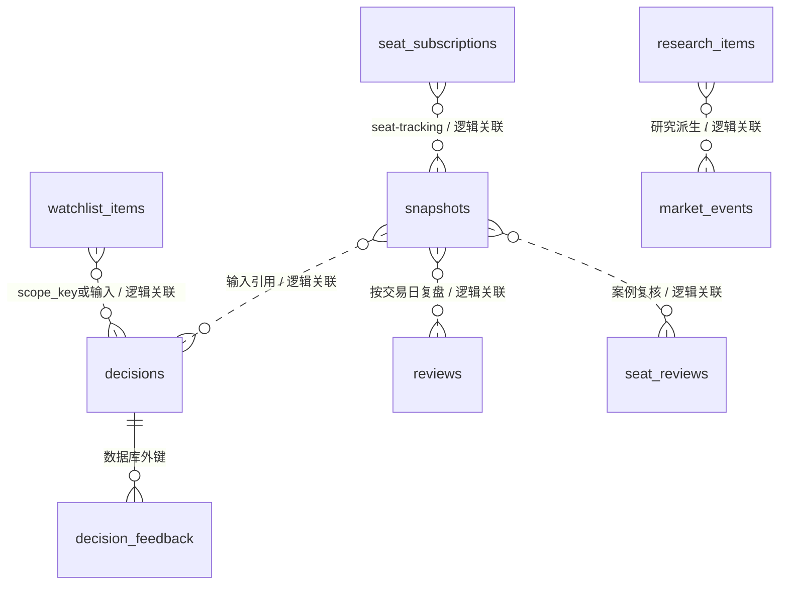
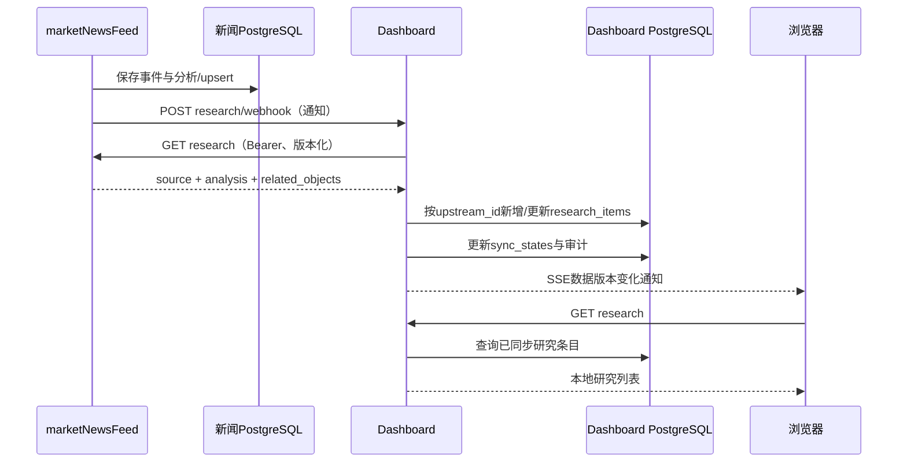

# Investment Platform 完整数据架构

核对日期：2026-10-13。范围：investment-platform、stock-analyzer、marketNewsFeed、investment-research-dashboard。

这是基于代码、表定义、契约、调度及部署文档核对的当前架构。股票和Dashboard采用CHG-20261013-002隔离工作区，包含尚未提交/合并/部署的“市场结构与ETF”模块；新闻仓库只读核对。本文不宣称所有开关已在生产启用，也不是生产数据库实盘盘点。生产Tag/SHA、数据库行数、硬件容量、备份执行情况未在线核验，状态UNKNOWN。

代码定义中共58张业务/认证/运行/保留表（含两张未找到当前业务读写路径的遗留账本）：stock-analyzer 32张、marketNewsFeed 11张、Dashboard 15张；不计Alembic版本表、历史归档、外部飞书表及PostgreSQL内部表。“有表定义”不等于该表在生产已建成、已有数据或对应任务已开启。

细化查阅：[字段与血缘业务手册](/Users/mukun/.codex/worktrees/market-structure-etf/investment-platform/docs/data-architecture-detail-2026-10-13.md)、[表—函数读写索引](/Users/mukun/.codex/worktrees/market-structure-etf/investment-platform/docs/data-table-function-index-2026-10-13.md)、[API参数与处理索引](/Users/mukun/.codex/worktrees/market-structure-etf/investment-platform/docs/data-api-function-index-2026-10-13.md)。

配套：[完整字段与约束附录](/Users/mukun/.codex/worktrees/market-structure-etf/investment-platform/docs/data-model-fields-2026-10-13.md)。

## 1. 总体结构与边界

平台由两个主要数据Provider、一个消费和交互服务、一个治理仓库组成。业务数据分散在各服务自有PostgreSQL边界内；可部署于同一物理PostgreSQL实例，但不因此共享业务数据库、表访问权限或事务。

图中连接表示数据或命令方向，不是固定部署串行链。特别是：stock-analyzer不依赖新闻库；Dashboard不直接读取上游PostgreSQL；Webhook不传完整研究业务对象；飞书是派生展示出口，不能据此把两个Provider视为一个主库。

| 服务 | 主数据职责 | 自有持久化 | 对外职责 |
| --- | --- | --- | --- |
| stock-analyzer | 行情、证券分类、交易规则、自选主记录、短线/波段计算及结果 | PostgreSQL；另有告警/板块运行JSON状态 | 版本化行情和策略API、股票管理命令、可选报告/通知 |
| marketNewsFeed | 新闻原文、事件、分析信号、主题热度、推送与来源健康 | PostgreSQL；另有历史已见/已发送JSON状态 | research API、通知Webhook、外部推送、研究报告 |
| Dashboard | 上游数据副本与用户研究工作流 | PostgreSQL，SQLAlchemy模型与Alembic迁移 | 页面API、同步、决策/复盘/反馈、认证 |
| investment-platform | 跨仓治理记录 | Git中的YAML/Markdown/证据文件 | 不运行行情采集，不承载业务数据库 |

## 2. 数据分层：事实、计算、投影、用户记录

以下是对当前模型的逻辑归类，代码未建立统一数据仓库，也没有强制全平台采用同一套分层表名。

| 层次 | 含义 | 典型实例 | 可否当成事实 |
| --- | --- | --- | --- |
| 外部输入 | 第三方接口和原始信息 | 股票行情、ETF份额/净值、新闻原文、龙虎榜 | 要验证来源、单位、业务日期及覆盖 |
| 标准化事实 | 服务整理并保存的观测 | a_share_daily_close、swing_daily_bar、events、market_structure_fact | 保存的是观测；仍需区分修订、缺失与历史重建 |
| 特征与规则结果 | 计算得出的指标和状态 | a_share_daily_metric、swing_feature_snapshot、short_candidate_snapshot、signals | 属于派生结果；新闻signals可包含LLM观点 |
| 状态事件与结果账本 | 状态变化及后续结算 | short_signal_event/outcome、swing_state_event/outcome | 记录规则事件/理论结果，不等于真实成交 |
| 下游投影 | 面向页面的上游数据副本 | snapshots、research_items、watchlist_items中的行情字段 | 可追溯至上游，但不是事实源的替代拥有者 |
| 用户工作流 | 本服务拥有的研究与操作信息 | decisions、decision_feedback、reviews、seat_reviews | 用户判断、规则结论与事实需要分开 |
| 运行与审计 | 同步、采集、发送和权限记录 | job_run、sync_states、audit_logs、feishu_sync_queue | 证明流程状态，不证明投资预测有效性 |

业务主库统一采用PostgreSQL，不代表全平台所有数据都已入库，也不代表所有表都追加不可变：最新状态表、按日归档表、版本化快照、事件账本采用不同更新策略。

## 3. 外部来源与落库方式

| 输入域 | 代码中接入来源/适配器 | 主要使用方式 | 持久化边界与限制 |
| --- | --- | --- | --- |
| A股行情、分类、公司资料 | AKShare适配、东方财富、腾讯等；不同模块主备源不同 | 定时缓存、日线采集、按需查询 | 核心行情进入Provider PostgreSQL；部分查询只做内存缓存 |
| 日线与分钟K线 | swing_daily_data、swing_intraday_data、候选历史及通用bars适配 | 预热特征、盘中确认、图表 | swing/短线相关事实落库；候选SDK历史存在进程LRU缓存路径 |
| 市场与板块资金流 | 东方财富公开市场/板块接口 | Provider按请求组装；Dashboard按日归档 | 资金流接口不等于本地完整逐分钟历史仓库 |
| 龙虎榜与营业部席位 | 东方财富龙虎榜/AKShare | 席位目录、逐席位交易查询、追踪 | Provider存在按需查询和LRU缓存；Dashboard保存观察快照与复核记录 |
| 美股与宏观资产 | Yahoo Finance适配；行业与A股映射为本地版本化配置 | 收盘到A股盘前事实快照 | us_market_snapshot保存结果；预测保持fact_only直到独立模型验证 |
| 美股宏观/财报日历 | Federal Reserve、BEA、Alpha Vantage等代码路径 | 定时日历拉取 | us_market_calendar_event/run；财报源启用依赖配置，本文未调用 |
| 新市场结构指数/股票/ETF | 东方财富、腾讯、沪深官方份额、东方财富F10净值、新浪日历 | 显式历史回填与增量采集 | market_structure_fact/generation；缺口不填0，不替代缺失A500指数 |
| 新闻快讯 | MKTNews | 持续采集、规则/模型处理、推送 | events/signals及渠道状态 |
| 研究新闻 | CTEE、Digitimes TW/Asia、日経、Nikkei Asia、Google News、百川盈孚、NVIDIA、AMD、TrendForce等配置 | 各来源独立轮询、相关性与分析 | events/signals/topic_heat；来源存在不等于已开启或始终可用 |
| 社交 | Truth Social、X Watch | 持续监控/翻译/分析/渠道推送 | 事件账本与x_watch_*；本地已见状态仍需保留 |

本次整理只静态核对代码和文档，没有运行新闻采集、LLM、真实推送或访问生产数据库。来源的当前可用性仅市场结构Change已有实测证据，其余不可据本表宣称已实时验证。

## 4. stock-analyzer：32张表的完整目录

### 4.1 行情、分类及运行底座

| 表 | 粒度/关键标识 | 核心数据与用途 |
| --- | --- | --- |
| a_share_snapshot | 交易日＋证券代码 | 当日最新行情：价格、涨跌、成交额、换手、行业、涨停信息；update_time保留实际更新时间，不是每次抓取都新增一行 |
| a_share_daily_close | 交易日＋证券代码 | 按日价格/成交额，服务跨日计算；save_snapshot盘中也更新该表，当前日值不能仅凭表名认定最终收盘 |
| a_share_daily_metric | 交易日＋证券代码 | 3/5/10/20/30/60日收益、均线距离、RS、成交额比、风险/趋势/强度等分数 |
| a_share_security_profile | 证券代码 | 名称、板块、行业层级、分类体系/来源/生效日等最新主数据 |
| security_classification_snapshot | 日期＋分类类型＋来源 | 分类采集批次的应有/成功数量、状态、生成时间 |
| security_concept_membership | 日期＋代码＋概念名＋来源 | 按日期保存的证券—概念成员关系 |
| security_trade_rule | 交易日＋代码 | ST/停牌、上市日、涨跌停幅度和价格、tick、无涨跌幅限制日 |
| job_run | 自增id | 定时任务开始/结束、状态、日期与消息；记录任务执行，不是行情本身 |

行业资料是最新主档，概念成员有日期快照；不能假定所有分类维度已有完整历史有效区间。

### 4.2 涨停和短线引擎

| 表 | 粒度/关键标识 | 用途 |
| --- | --- | --- |
| limit_up_snapshot_run | 交易日＋快照时间 | 抓取批次、来源、是否最终版、条数、质量问题 |
| limit_up_snapshot | 交易日＋快照时间＋代码 | 涨停个股、封板/炸板/连板信息、行业主题与涨停原因证据 |
| intraday_market_snapshot | 交易日＋快照时间 | 上涨占比、涨跌停数、炸板比、成交额、原短线市场状态 |
| intraday_sector_snapshot | 交易日＋快照时间＋板块类型/代码 | 板块强度、广度、量增、资金延续、生命周期与核心结构 |
| intraday_stock_bar | 交易日＋分钟＋代码 | 量价观测与VWAP；volume/amount为日内累计，历史区间量先转同口径 |
| short_candidate_snapshot | 交易日＋快照时间＋代码＋规则版本 | 候选类型、角色、机会/风险分、级别、状态、解释、pending计数 |
| short_signal_event | signal_id | 状态变更、信号/行情时间、规则版本、理论入场参考 |
| short_signal_outcome | signal_id | 次日开/低/收、3/5日结果、MFE/MAE、路径、不可交易原因 |
| setup_pattern_ledger | 交易日＋代码＋形态 | 遗留保留定义：匹配因子、关键位、触发后收益；未找到当前业务读写路径 |
| short_factor_ledger | 交易日＋代码 | 遗留保留定义：风险桶、因子与结果；未找到当前业务读写路径 |

### 4.3 波段引擎

| 表 | 粒度/关键标识 | 用途 |
| --- | --- | --- |
| swing_daily_bar | 交易日＋代码 | 原始/调整OHLC、成交额、成交量、换手率 |
| swing_index_daily | 交易日＋指数代码 | 相对强度基准价格 |
| swing_feature_snapshot | 交易日＋代码＋特征版本 | 位置、区间、ATR/NATR、波动/回撤、均线斜率、量价、RS、枢轴、资格覆盖 |
| swing_setup_snapshot | 交易日＋代码＋形态＋规则版本 | 形态匹配、机会/风险、关键位/止损参考、状态、确认、参与决策与执行动作 |
| swing_state_event | event_id | 形态状态变化、事件/数据时间、量价证据和规则版本 |
| swing_signal_outcome | event_id | 理论入场、风险R、次日/3/5/10日结果、MFE/MAE、相对收益与结算 |

同日同规则的setup可能重建覆盖；state_event/outcome保留事件及结果。波段采集存在筛选与数据资格条件，不能把其样本数自动视为完整全A证券池。

上述为计算与逻辑关联；Provider表主要依赖主键和业务键，没有为这些关系统一声明数据库外键。

### 4.4 美股事实、日历及自选

| 表 | 粒度/关键标识 | 用途 |
| --- | --- | --- |
| us_market_snapshot | snapshot_id | A股观察日、美国交易日、快照类型、特征/映射/模型版本、覆盖、质量、JSONB事实结果 |
| us_market_calendar_event | event_id | 宏观/财报事件、计划时间、实际/预期/前值、来源和资产/板块关联 |
| us_market_calendar_run | run_id | 日历采集区间、覆盖、质量、问题及生成时间 |
| watchlist_item | id；security_id唯一 | Provider自选主记录：市场/交易所/类型、关注等级、加入原因、分类、最近报价/信号、revision |
| watchlist_strategy_snapshot | 自增id | 自选revision、短线/波段规则版本、聚合策略JSONB；当前代码仅保留最近40条 |
| watchlist_alert_event | id | 自选价格/涨跌触发事件、方向、档位、报价及投递渠道 |

自选主记录与Dashboard的用户研究状态分属两个拥有者，详见第9节。美股观察日和美股收盘交易日不是同一个字段，不应直接按同一天进行跨市场join。

### 4.5 本次新增：市场结构与ETF

| 表 | 关键字段 | 保存方式 |
| --- | --- | --- |
| market_structure_fact | kind、entity_id、trade_date、fact_hash、first_seen_at、payload | 按对象/日期/内容哈希追加；相同事实幂等 |
| market_structure_generation | trade_date、phase、rules_version、input_hash、first_available_at、payload | 按日期/阶段/规则/输入追加计算代次 |

事实kind包括calendar、universe、stock、quote、index、share、nav、etf_price、mapping、adjustment_check、sync。日期字段在这两张表为TEXT；首次观测/可得时间为TIMESTAMPTZ。

payload保存标准化值、原始字段/单位与转换倍率、来源和采集信息；不是保证逐条保存完整HTTP响应体。generation包含market、indices、styles、funds、groups、regime、quality、history_integrity及计算/映射版本。

单位：金额CNY元，份额“份”，单位净值元/份；UI将金额转亿元。申赎估算=(当日份额−上一真实交易日份额)×当日单位净值。严格同日配对和1/5/20真实交易日完整窗口，缺数为null。8组12只代表ETF不等于完整ETF母集合，更不能识别机构。

新模块复用旧行情缓存和交易规则只读输入，不改原短线/波段状态枚举和评分。默认关闭；当前代码尚未部署。

## 5. marketNewsFeed：11张表的完整目录

| 表 | 主键/粒度 | 主要字段与职责 |
| --- | --- | --- |
| events | event_id | source/source_id/source_url、原始/中文标题正文、pub_time/fetched_at、相关性、等级、推送状态、raw_json |
| signals | event_id | 优化标题、summary/insight、A股/美股映射、方向、催化、强度、持续期、主题、产业链、风险、model、analysis_json |
| topic_heat | topic_date | topic＋heat_date、事件数量、等级数量、heat_score、强度、趋势、最后事件 |
| ashare_map | topic＋ticker | 主题到A股证券的名称/行业/权重/备注映射 |
| daily_briefings | briefing_date | 简报content_json、创建/更新时间、发送时间 |
| source_runtime_state | source | 来源健康、失败计数、blocked_until、最后错误/成功 |
| feishu_sync_queue | 自增id | 对象类型/ID、动作、payload_json、状态、retry_count、next_retry_at及错误 |
| feishu_record_map | object_type＋object_id＋table_id | 主库对象到飞书record_id的映射 |
| x_watch_users | user_id | 账号/列表、active、最近帖子/检查、原始数据 |
| x_watch_posts | post_id | 作者、帖子原文、翻译/摘要/观点/映射/风险、各渠道状态、发送尝试和时点 |
| x_watch_api_usage | 自增id | endpoint、资源类型/数量、estimated_cost、触发原因与时间 |

新闻模型多数时间和JSON内容使用TEXT，而不是Dashboard的TIMESTAMPTZ/JSONB；业务层负责解析。signals.event_id与events.event_id是逻辑1:0..1关系，DDL没有强制FK：历史迁移保留了少量信号孤立记录，不能在说明中假设全量参照完整。

主流程先可靠持久化事件/分析，再进行相关派生和通知；部分步骤可重试或降级。events/signals采用upsert更新，不是完整的不可变新闻分析修订仓库。模型名称有保存，但不能等同每次prompt、输入和所有模型修订均有独立历史表。

X原生记录保存在x_watch_*，研究API输出经账本与适配器筛选；不能假设每条原生X帖都已自动同步为Dashboard research_items。

## 6. Dashboard：15张表的完整目录

### 6.1 投影与业务工作流

| 表 | 关键标识 | 职责与数据拥有者 |
| --- | --- | --- |
| snapshots | UUID；domain/key/version等业务键 | 通用JSONB投影/缓存；不同domain有不同更新与归档规则 |
| research_items | UUID；upstream_id唯一 | 新闻Provider研究副本；也支持本地人工研究条目，保留source_payload与analysis分层 |
| watchlist_items | UUID；upstream_id唯一 | 自选行情/分类副本＋Dashboard的研究状态、策略偏好、阶段、触发/失效条件 |
| market_events | UUID；upstream_id唯一可空 | 上游/派生事件及本地处置状态、前后值、规则、details |
| decisions | UUID | 确定性策略结论、证据/反证、质量/截止时间、模型/策略版本、用户确认状态与input_summary |
| decision_feedback | UUID；decision_id FK | 对具体决策的状态反馈/理由；删除父decision时CASCADE |
| reviews | UUID；trading_date唯一 | 按日复盘：市场摘要、决策结果、误差类型、用户笔记、指标和时间线 |
| seat_subscriptions | UUID；code唯一 | 本地席位订阅、别名、标签、优先级、active及备注 |
| seat_reviews | UUID；key唯一 | 席位/案例复核payload、观察日、收藏、用户备注与反馈 |
| sector_scores | UUID | 板块分类/名称、涨幅、fund_flow、activity、diffusion、score、core_stocks、evidence_kind、business_time；不能保证每条记录均为真实生产自动计算 |
| sync_states | UUID；upstream唯一 | 最近同步成功时间、状态、记录数量、源版本和说明 |
| audit_logs | UUID | 操作时间、动作、目标类型/ID及JSONB详情 |

### 6.2 认证与登录安全

| 表 | 数据 | 说明 |
| --- | --- | --- |
| dashboard_users | username唯一、password_hash、role、active、last_login_at | 本地账号；所有账号共享单操作人数据空间，不是按用户隔离的多租户模型 |
| captcha_challenges | source_hash、目标位置、过期/验证/消费时点、token_hash、失败次数 | 一次性短期挑战，不保存明文挑战Token |
| login_attempts | occurred_at、subject_hash、source_hash | PostgreSQL支持的登录节流记录 |

Dashboard大量表用UUID主键、TIMESTAMPTZ时间、JSONB扩展字段。TimestampMixin提供created_at/updated_at。除decision_feedback→decisions外，本模型文件没有统一为其他领域关系声明FK；source对象通常用upstream_id、domain/key、证券代码或payload引用关联。

虚线关系为概念关联，不代表数据库外键，也不保证每条记录都有另一侧对象。

## 7. snapshots各domain与历史能力

snapshots是共享容器，不能因为表名叫Snapshot就认定所有domain不可变。实际写入者决定唯一键、更新方式和历史粒度。

| domain | 写入/用途 | 历史或更新语义 |
| --- | --- | --- |
| capital-flow | 定时或请求获取资金流后归档 | 按交易日key更新；当前日可覆盖，历史读取归档；不是完整分钟修订历史 |
| short-selection | 定时/请求同步短线 | 按交易日归档更新；更细事件历史由Provider持有 |
| dashboard | 驾驶舱存储/兼容与演示路径 | 当前真实驾驶舱可由同日短线＋资金流投影组合，不能把所有dashboard domain行当真实数据 |
| swing-selection | 选择/展示波段数据 | 保存与具体请求/规则相关的投影；Provider为形态/事件历史拥有者 |
| limit-up-ladder | 请求查询并缓存涨停梯队 | Provider保存批次和个股快照；Dashboard保存消费侧结果 |
| seat-flow | 请求龙虎榜席位并保存 | 按观察对象和日期归档；不意味着全部营业部历史已入库 |
| seat-flow-ai | 用户显式分析席位 | 解释结果缓存，与模型身份/事实输入关联 |
| seat-tracking | 定时订阅席位追踪 | 保存聚合观察快照；单对象失败可保留旧结果并标记 |
| seat-outcomes | 订阅席位后续结果 | 结果回填保存；缺口/失败不伪造收益 |
| company-profile | 按需公司资料摘要 | 原始资料＋可配置AI摘要缓存；不属于完整公司财务事实仓库 |
| us-market | 美股到A股盘前同步 | 使用Provider快照身份保存；失败保留之前可用结果 |
| us-calendar | 美股事件日历同步 | 按Provider结果保存与查询，实际事件日期另存payload |
| market-structure | 本次新增模块后台同步 | 交易日＋input_hash＋契约版本追加；部分唯一索引避免重复；GET只读 |

`uq_market_structure_projection`只对domain='market-structure'提供(domain,key,version)唯一约束，不是全snapshots表通用唯一约束。`ix_market_structure_history`支持domain/version/business_time/created_at历史筛选。

## 8. 页面究竟读本地还是接口

应区分三段：浏览器→Dashboard、Dashboard→Provider、Provider→外部来源。“页面调用后端API”不说明最终来源一定在本地，也不说明每次都访问第三方。

| 页面/能力 | Dashboard读取路径 | 外部依赖和历史能力 |
| --- | --- | --- |
| 市场驾驶舱 | 真实路径组合本地短线/资金流同日投影；另有已有存储/演示路径 | 上游由后台或其他接口刷新；不跨库 |
| 市场结构与ETF | GET只读本地market-structure投影 | Provider采集与计算独立执行，查询不抓外部 |
| 资金流向 | 当日查询可同步Provider并归档；历史读本地；失败读最近归档 | Provider资金流组装可请求东方财富 |
| 短线选股 | 最新可同步上游并保存；历史归档/Provider事件分别提供 | 行情引擎与底层数据质量影响可用性 |
| 板块工作台 | 请求Provider sector-workbench契约 | Provider从本地日线、分类等计算；非Dashboard独立事实表 |
| 波段选股 | 请求Provider选择/统计/事件历史，部分响应存投影 | bars/日线与特征主要由Provider持有；部分图表可走按需适配 |
| 股票K线 | Dashboard转发受保护Provider接口 | 各bars/candles端点可能查缓存/本地/SDK；不能概括为全量K线都已持久化 |
| 席位资金流 | 请求Provider并保存seat-flow；AI需显式分析请求 | Provider按需公开龙虎榜查询，只有已查询/追踪对象有下游记录 |
| 席位订阅 | 本地订阅＋后台拉取＋本地快照 | 失败保留可用对象；不是全席位持续采集 |
| 自选列表 | 本地watchlist_items投影；后台同步与显式命令 | Provider掌握主列表；报价刷新也有按需但不持久化的接口路径 |
| 研究信息库 | 本地research_items | Webhook/人工同步从新闻research契约拉取 |
| 决策与复盘 | 本地输入快照、业务表、用户反馈 | 当前decision_engine为确定性策略引擎，模型名称明确“AI模型待接入”；不等同所有结论均由LLM生成 |
| 美股隔夜映射 | 本地us-market/us-calendar投影及历史 | Provider事先采集Yahoo/官方日历等，模型预测状态fact_only |

这一区分也决定故障影响：本地投影正常时可以继续展示；按需上游路径会受Provider/第三方延迟影响。不是所有接口都已经具备同样的最近可用降级逻辑。

## 9. 三条完整数据血缘

### 9.1 自选管理：主记录与本地研究状态

1. 用户在Dashboard发起搜索/添加/暂停/恢复。
2. Dashboard调用stock-analyzer的股票管理命令；成功后同步本地投影。
3. Provider watchlist_item保存证券主记录、关注属性、最近报价/信号及revision。
4. Dashboard watchlist_items保存上游ID/行情/分类，并拥有research_status、strategy_preference、position_stage及研究条件等本地字段。
5. 后台周期同步更新上游字段；用户工作流不能被当成行情事实回写上游。

这是两服务间的命令＋同步流程，没有分布式事务，也没有跨库FK。Provider成功但Dashboard后续写失败时可能短暂不同步，需要后续同步/审计纠正，不能声称严格原子一致。

### 9.2 新闻分析完成到研究页面更新

Webhook采用独立Secret，接收端再拉只读契约。SSE broker是进程内通知，不是持久消息队列；服务重启不会因此丢失已入库研究，但瞬时通知不具备跨进程持久消费语义。

### 9.3 市场结构与ETF

采集接口→验证交易日/证券池/单位→追加fact→离线指标与规则计算→追加generation→Bearer Provider API→Dashboard Pydantic契约校验→追加market-structure快照→本地GET→Vue图表。

对每条ETF资金结果，可追溯到：交易所/代码、当日和上一交易日份额、当日单位净值、调整事件检查、映射版本、来源时点、输入哈希、计算规则版本。不能完整验证配对/拆分/窗口时，资金值留空并记录原因。

## 10. 跨服务契约与身份

| Provider | 主要接口族 | 契约/版本例子 |
| --- | --- | --- |
| stock-analyzer | watchlist、company-profile、monitor、nextday-watch | investment-dashboard-watchlist-v1 / company-profile-v1 / monitor-v1 / nextday-v1 |
| stock-analyzer | capital-flow、sector-workbench | investment-dashboard-capital-flow-v1 / sector-workbench-v1 |
| stock-analyzer | short-selection、market-regime、short-history | short-selection-engine-v1 / short-history-v1；原市场状态与新市场结构分开 |
| stock-analyzer | limit-up-ladder、seat-flow、seat-tracking | limit-up-ladder-v1 / seat-flow-v1 / seat-tracking-v1 |
| stock-analyzer | swing-selection、candles、history、stats | selection-v3（兼容v2）、swing-candles-v1、swing-history-v2、swing-stats-v2 |
| stock-analyzer | stocks/{code}/bars等 | stock-bars-v2及相应K线适配契约 |
| stock-analyzer | us-market/overnight、calendar、history | us-market-v1 / us-calendar-v1 / us-market-history-v1 |
| stock-analyzer | market-structure（未发布） | investment-dashboard-market-structure-v1 |
| marketNewsFeed | research | investment-dashboard-research-v1 |
| 跨服务命令/通知 | POST股票管理；GET通用股票查询；research/webhook | 部分仍未版本化，不能假定有完整契约兼容保护 |

除明确写完整前缀的项外，表中短名均指investment-dashboard-*契约族。Bearer保护Provider接口；用户浏览器通过Dashboard自身登录权限访问，不应取得Provider Token。

application_version表示软件发布；contract_version表示API形状/语义；rules_version表示判定规则；feature_version表示特征口径；mapping_version表示对象映射；model_version表示模型身份。它们需要分别追踪，不能用一个版本号代替。部分旧接口用camelCase，另一些用snake_case，Consumer适配负责显式校验，不存在全平台单一Envelope。

当前代码基线：治理1652fa9262ec856db94b324c8cc25040ca628b24；stock-analyzer 707d619916e2ad745bded153f1d4cdede7d705c9＋本地3.24.0改动；Dashboard ceb1b03d15c18973f3d3c6d9574384e680293d74＋本地0.19.0改动；新闻138ea7cbebfa17df0b27f52b7b15e2907a8eec65。新闻统一应用版本源仍按治理记UNKNOWN，组件版本不代替应用版本。

## 11. 采集、计算与同步调度

以下为代码默认值或现有注册方式，不是已核验的生产开关和Cron。业务时区主要Asia/Shanghai，最终频率受环境配置、交易日判断、模块开关及独立运行模式控制。

| 服务/任务 | 默认或机制 | 写入与失败处理 |
| --- | --- | --- |
| Provider行情缓存 | HOTMAP_CACHE_REFRESH_*；默认09:35至14:55每5分钟 | a_share_snapshot等；不能把未到市场窗口的旧报价标为今日 |
| 分类/交易规则 | 分类08:20、交易规则08:35 | 分类批次、成员、trade_rule；启动catch-up另有条件 |
| 短线引擎 | watch常驻、配置full_scan_seconds等；脚本有开关 | 市场/板块/候选/事件；结果回填注册15:45 |
| 波段引擎 | 盘中cycle＋日线scan＋结果回填；频率配置 | bar/feature/setup/event/outcome，质量与确认条件独立 |
| 自选策略 | refresh_watchlist_strategy注册16:10；告警watch常驻 | 主记录/策略/告警；仅最近40条策略聚合快照 |
| 美股Provider | 专用收集脚本/时点与运行模式 | 美股事实和日历run；失败可保留此前数据 |
| 新市场结构 | 默认关闭；开启后17:10/20:30/08:10；首次回填独立授权开关 | append-only事实/代次；PG advisory lock，当前CLI会重算完整窗口 |
| 新闻 | run_all监管MKTNews、Truth、ResearchFeed、趋势报告、X和Admin API | 各来源独立轮询/cron；来源健康退避；推送和飞书重试有独立状态 |
| Dashboard自选 | 默认60秒，非Demo且上游配置完整才启用 | watchlist_items及sync_states |
| Dashboard资金流/短线 | 默认300秒，另有页面请求触发 | 按日归档；失败保留此前可用数据 |
| Dashboard席位订阅 | 默认3600秒 | 订阅对象观察快照及失败保留 |
| Dashboard美股 | 默认05:45/08:05/08:15 | us-market/us-calendar投影；本地交易日/源日期区别 |
| Dashboard新市场结构 | 默认模块关闭；开启后默认1800秒；0禁用自动同步 | 每日期/输入哈希追加，重复不新增 |
| Dashboard研究 | 上游Webhook或人工POST同步 | research_items upsert、sync_states、审计、SSE通知 |

Provider scheduler用子进程执行任务并写job_run；部分任务后台线程并行。锁只限制特定任务重复，不提供硬件CPU/内存隔离。Dashboard后台维护为进程内async task/to_thread；多Worker部署不能仅依赖进程锁假定全局一次执行，需评估各模块数据库幂等与实例拓扑。

## 12. 时间、主键、单位和历史可得性

### 12.1 时间语义

| 字段族 | 含义 | 不能混淆为 |
| --- | --- | --- |
| trade_date / trading_date | A股业务交易日 | 获取时间、美国交易日 |
| us_trade_date | 美国源市场交易日 | A股观察日 |
| pub_time / published_at | 新闻或数据公开发布时间（若源提供） | 系统采集时刻 |
| data_time / quote_date / snapshot_time | 源行情或业务快照时点 | HTTP响应/系统生成时间 |
| fetched_at / first_seen_at | 抓取或首次观测时间 | 历史来源真实发布时间 |
| generated_at / first_available_at | 计算生成/该代次首次可得 | 已回填日期当天就已知 |
| business_time | Dashboard投影对应业务时间 | 通用的第三方实时行情时刻；新模块设交易日15:00用于归档，实际报价时点另在payload |
| created_at / synced_at / updated_at | 入库、同步、更新 | 数据对应的市场日期 |

存储并未全平台统一：Provider很多日期/时间为TEXT，新闻多为TEXT，Dashboard多为TIMESTAMPTZ；新市场结构首次可得时间用TIMESTAMPTZ。因此字符串排序、时区解析和跨表join需要按具体契约处理。

历史能力也不同：a_share_snapshot按日保留最新值，不是全盘中报价日志；events/signals upsert不提供每版分析历史；新增market_structure_generation按哈希保留代次；策略事件和结果账本则保留事件粒度。当前项目不是全域双时间数据库。

### 12.2 主键与对象身份

股票主档code之外，跨市场自选采用security_id；ETF以交易所＋代码区分；新闻event_id/source_id、Dashboard upstream_id保留来源身份；规则事件采用signal_id/event_id；投影采用domain/key/version。

不能只按name、只按6位代码或只按trade_date跨域合并：名称可改，证券市场可能不同，快照同日可能多代次，新闻事件与策略event_id也不共享命名空间。

### 12.3 单位

大部分金额在数据层用CNY元，UI可转亿元；旧短线候选明确有amount_yi列，不能与amount直接拼接。收益pct按5.2表示5.2%的契约展示，百分比之差用pp；不同旧表仍须核对字段口径。原始OHLC与adjusted_*必须分开，原始价格用于名义平均价格，调整价格用于部分历史特征。

### 12.4 新模块known/rebuilt

known以请求日期截止时真正已保存的首次可得记录筛选；rebuilt用于已收集事实的事后重建。2026-10-13补齐的2026-04-15行情不能在known模式冒充4月15日当时已有的系统信号。股票日线完整也不能自动证明历史证券池、历史ST或停牌成员完整。

## 13. 幂等、一致性、修订和质量

| 模型 | 当前处理 | 限制 |
| --- | --- | --- |
| 最新状态/主记录 | 业务键upsert、revision或更新时间 | 更新可覆盖旧值，不能直接恢复每个历史版本 |
| 按日投影 | 当日key归档并可更新 | 当前日快照不是不可变分钟历史 |
| 策略事件 | signal_id/event_id唯一 | FK多为逻辑关系，需应用层保证归属 |
| 新闻研究同步 | upstream_id唯一、source与analysis分层更新 | 分批读取/筛选不保证全新闻账本已全量复制 |
| 新结构事实/代次 | 内容/输入哈希唯一、追加、首次可得时间 | 源最终价格修订保留初值并标source_revision_pending；不自动把修改当正常补数 |
| 飞书派生 | 队列重试＋record map | 不与主库及外部推送构成分布式原子事务 |
| 服务间同步 | HTTP契约校验、本地提交、SyncState | 最终一致；上游成功不等于下游写入必然成功 |

质量字段包括healthy/partial/stale/unavailable、coverage、issues/reason_codes、source_status、is_mock等，具体枚举按契约；旧接口还有normal/degraded或中文状态，不能假定一套全局枚举。is_mock必须与真实数据显式区分，Demo存在不代表生产使用Demo。

新模块当前实测：沪深5225只、今日有效收益覆盖100%、MA20资格5203/99.58%、MA60资格5173/99.00%；9个指数源可用，A500指数不可用；ETF代表12只。历史价事实约96万条，起于2025-12-31；展示窗口2026-04-15至10-13共120交易日，加前一基准日4月14日共121代次。历史池不完整使正式状态研究样本为0，结论insufficient_history，不能声称阈值已获得预测有效性验证。

健康检查和readiness也应分开：/health证明进程/连接的局部状态；Dashboard readiness按配置领域的真实快照存在性与新鲜度判断，不是对所有第三方源或投资结论的实时质量担保。

## 14. 非数据库存储、备份与保留

| 存储 | 作用 | 是否主业务事实源 |
| --- | --- | --- |
| Provider logs/alert_state.json | 告警去重、状态及监控辅助 | 不是行情主库，但丢失可能造成告警行为变化 |
| Provider logs/sector_event_state.json | 板块状态变化/事件，资金流可读取 | 有实际运行语义，不能当无关日志任意删除 |
| Provider进程LRU缓存 | 候选历史、席位目录等请求加速 | 重启丢失；不是持久历史 |
| 新闻sent_ids/seen_ids JSON | MKTNews/Truth已见/已发送与补发状态 | 主事件在PG，但这些文件仍影响去重与补发 |
| 飞书Base/Sheets/Doc报告 | 主数据派生输出、展示、近期标记 | 可关闭；主库不是飞书 |
| Dashboard进程SSE broker/锁 | 通知与本进程同步协调 | 非持久队列/分布式锁 |
| 治理Git文档 | Change、依赖、Release身份与证据 | 是治理事实；未提交内容尚非共享记录 |
| 历史SQLite归档 | 新闻旧快照 | 当前新闻运行后端已移除SQLite，不恢复运行依赖 |

已查到的具体保留机制：Provider自选策略快照最近40条；新闻MKTNews已发送ID与Truth已见ID代码默认保留30天；飞书近期/保留清理作用于派生记录映射和外部展示，不应误解为清理PG新闻事实；Dashboard登录节流记录有过期清理。未发现全平台统一的行情/事件/审计/快照保留与分区政策，不推测“所有历史永久保存”。

迁移：Provider local_db使用幂等CREATE/ALTER加字段；新闻db_schema＋启动时增量列处理；Dashboard Alembic管理结构，新市场结构只加部分唯一/历史索引，downgrade不删除投影数据。

备份应按独立数据拥有者分别覆盖PostgreSQL，以及仍影响运行的JSON状态文件。新闻设计规定重要操作前pg_dump，备份可置data/backups，恢复停应用→恢复→启动验证。当前未核验三服务生产备份频率、异机副本、恢复演练或RPO/RTO，不能依据有备份脚本/文档就宣称已达到恢复目标。

## 15. 连接配置、权限与部署边界

| 服务 | 自有数据库配置 | 上游/API配置 |
| --- | --- | --- |
| stock-analyzer | STOCK_ANALYZER_DATABASE_URL、STOCK_ANALYZER_DB_SCHEMA | STOCK_API_HOST/PORT/TOKEN；可选飞书/行情源配置 |
| marketNewsFeed | MARKET_NEWS_PG_DSN及配套数据库配置 | MARKET_NEWS_API_HOST/PORT/TOKEN；TREND_STOCK_API_BASE/STOCK_API_TOKEN；DASHBOARD_WEBHOOK_* |
| Dashboard | DATABASE_URL | STOCK_ANALYZER_BASE_URL/TOKEN；MARKET_NEWS_FEED_BASE_URL/TOKEN；独立Webhook Secret和登录配置 |

本文只列环境变量名称，不读取或记录真实Token、账号密码、DSN、Cookie和个人数据。各服务以自身数据库角色/库或schema为边界；实际生产GRANT、网络监听、端口、防火墙、数据库实例复用程度未在线核验。

PostgreSQL跨服务权限、API Bearer、Webhook Secret、用户登录、外部推送凭据是不同信任边界。前端不应连接数据库或携带Provider Token；HTTP拉取的结构仍需Consumer校验。

部署采用独立Repo/版本/Tag或精确镜像；新增功能不要求增加业务服务，但采集与计算共享主机资源。新模块本地完整121日重算306.37秒、峰值常驻内存约1.34GB；全窗口响应约5MB；缓存概览P95约686ms、历史633ms、Provider1001ms，全量重算并发时概览P95约1916ms。这是开发机实测，不是生产容量保证；CPU/内存隔离、批次/查询裁剪、生产资源观测需按实际部署评估。

## 16. 当前缺口与建议优先级

本节为基于上述实现的判断，不表示已授权改造。

| 优先级 | 缺口/风险 | 建议 |
| --- | --- | --- |
| 高 | 生产事实身份、实际库规模、权限、备份状态未核验 | 做一次授权后的只读生产盘点，补版本/库角色/行数/容量/备份证据 |
| 高 | 新模块历史证券池/ST/停牌及部分指数源缺口 | 保存可追溯的每日证券池和状态事实；先积累known，再谈历史正式状态评估 |
| 高 | 主库与下游用户字段的双服务一致性依赖应用同步 | 明确命令成功/投影失败后的重试和审计，不引入跨库直接写 |
| 中 | TEXT时间、单位和camel/snake契约历史差异 | 维护领域字典，新增接口明确日期/时区/单位，不一次性破坏迁移全库 |
| 中 | 部分按需接口依赖外部源；缺少完整持久历史 | 按实际使用价值逐域补事实与缓存，避免声称所有页面离线可用 |
| 中 | JSON状态与主库共存，进程锁/SSE非分布式 | 明确保留/备份与多实例约束；需要扩展时再决定统一持久状态 |
| 中 | 各domain更新方式不一致、通用snapshots缺统一保留策略 | 在领域文档明确唯一键、覆盖/追加、保留及索引；按规模再评估分区 |
| 中 | 未版本化的股票命令/通用查询/Webhook | 在对应Change中做兼容契约演进 |
| 中 | 新结构重算资源及5MB完整窗口响应 | 历史与逐基金原始审计按需读取；测生产资源后调整任务与窗口 |
| 后续 | 所有数据血缘尚未统一机器可查询 | 从契约/规则/输入哈希、source和upstream_id开始，不先搭额外数据平台 |

## 17. 证据路径与核对方法

主要实现依据：

- [平台边界与依赖](/Users/mukun/work/workspace/stock/investment-platform/SYSTEM_MAP.yaml)
- [Provider表定义](/Users/mukun/.codex/worktrees/market-structure-etf/stock-analyzer/stock_analyzer/local_db.py)
- [Provider API](/Users/mukun/.codex/worktrees/market-structure-etf/stock-analyzer/stock_analyzer/api.py)
- [Provider调度](/Users/mukun/.codex/worktrees/market-structure-etf/stock-analyzer/stock_analyzer/scheduler.py)
- [Provider配置](/Users/mukun/.codex/worktrees/market-structure-etf/stock-analyzer/stock_analyzer/settings.py)
- [新闻表定义](/Users/mukun/work/workspace/stock/marketNewsFeed/src/common/db_schema.py)
- [新闻账本及研究输出](/Users/mukun/work/workspace/stock/marketNewsFeed/src/research_feed/storage.py)
- [新闻PostgreSQL设计](/Users/mukun/work/workspace/stock/marketNewsFeed/docs/tech-design-postgresql.md)
- [Dashboard模型](/Users/mukun/.codex/worktrees/market-structure-etf/investment-research-dashboard/backend/app/models.py)
- [Dashboard API与请求路径](/Users/mukun/.codex/worktrees/market-structure-etf/investment-research-dashboard/backend/app/api.py)
- [Dashboard生命周期/后台任务](/Users/mukun/.codex/worktrees/market-structure-etf/investment-research-dashboard/backend/app/main.py)
- [市场结构交付与实测证据](/Users/mukun/.codex/worktrees/market-structure-etf/investment-platform/changes/evidence/CHG-20261013-002/delivery-report.md)

字段附录以AST读取固定DDL常量和SQLAlchemy声明生成，避免导入应用触发真实连接或任务；随后核对表清单、链接与文档差异。表总数58包含两张本地新增Provider表，不是58张全新表。代码基线与实际部署可能不同；后续Change修改模型/契约/管道时应同步修订本架构说明。

本次仅新增治理仓库文档并更新本地Change证据，业务代码与数据库没有修改；未Commit、Push、Merge、Tag或部署。保留原工作区其他任务文件和新闻test_discord.py不动。
