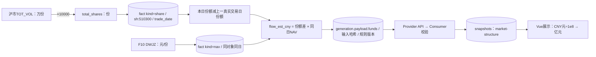

# 数据架构细粒度手册：字段、写入、血缘、API与页面

核对日期2026-10-13。承接全平台架构总览，进一步细化到业务粒度、字段值语义、存取函数、更新条件与消费链路。范围仍为当前源码与CHG-20261013-002未发布改动，不是生产数据库实盘报告。仅文档和静态索引，没有执行采集、模型、推送或业务SQL。

## 1. 四种查阅入口

| 要回答的问题 | 文档 | 颗粒度 |
| --- | --- | --- |
| 整个平台由哪些服务、领域、库构成 | [架构总览](/Users/mukun/.codex/worktrees/market-structure-etf/investment-platform/docs/data-architecture-2026-10-13.md) | 服务/领域/调度/治理 |
| 某张表每个字段的类型、键和约束 | [完整字段附录](/Users/mukun/.codex/worktrees/market-structure-etf/investment-platform/docs/data-model-fields-2026-10-13.md) | 全58张定义表的DDL或ORM列 |
| 谁读写某张表，在哪个函数哪一行 | [表—函数索引](/Users/mukun/.codex/worktrees/market-structure-etf/investment-platform/docs/data-table-function-index-2026-10-13.md) | 58表、341条函数引用；SQL与ORM证据分开 |
| 某个API的参数、处理函数和数据调用 | [API—函数索引](/Users/mukun/.codex/worktrees/market-structure-etf/investment-platform/docs/data-api-function-index-2026-10-13.md) | 110个FastAPI装饰器端点及签名/直接调用 |

本文解释关键字段的业务语义、口径与贯穿链路，而不是再复制一遍建表DDL。完整列清单在字段附录，完整存取证据在函数索引；这些索引是静态证据，不冒充运行调用追踪。动态helper参数、ORM引用不自动等于真实执行的写入。

## 2. 一条记录究竟代表什么

| 数据对象 | 一条记录 | 重复判定 | 不包含什么 |
| --- | --- | --- | --- |
| a_share_snapshot | 一只股票在某交易日的当前最新行情 | trade_date＋code | 不保留该日每次刷新完整轨迹 |
| a_share_daily_close | 一只股票某日的价格/成交额记录 | trade_date＋code | 表名不能证明当前日值已经最终收盘 |
| intraday_stock_bar | 一只股票某交易日某分钟的日内量价观测 | trade_date＋minute＋code | amount/volume不是该分钟的独立增量 |
| limit_up_snapshot | 某批次某只涨停股 | trade_date＋snapshot_time＋code | 不能脱离snapshot_run假定来源完整 |
| short_candidate_snapshot | 同时点、同规则的一只候选股 | 日期＋时点＋代码＋规则 | 不等同不可变信号事件 |
| short_signal_event | 某次状态变化 | signal_id | 不等于真实成交 |
| swing_feature_snapshot | 某日某股票某套特征口径 | 日期＋代码＋feature_version | 非全A池成员完整证明 |
| swing_setup_snapshot | 某日某股票某形态某规则的观察/判定 | 日期＋代码＋pattern＋rules_version | 同键可覆盖，且同日扫描可整体替换 |
| swing_state_event | 某股票某形态的一次状态变化 | event_id | 不代替setup当前状态 |
| swing_signal_outcome | 一次理论事件的后续结算 | event_id | 不代表用户真实持仓收益 |
| market_structure_fact | 对象/日期的一版来源事实 | kind＋entity_id＋日期＋fact_hash | 不等同每次抓取日志 |
| market_structure_generation | 日期/阶段/规则/输入的一版结果 | 日期＋phase＋rules_version＋input_hash | 不是一个交易日永远只有一行 |
| events / signals | 一个新闻事件及其当前分析 | event_id分别唯一 | 不是每次分析修订单独一行 |
| topic_heat | 一天一个主题的计数/分数状态 | topic_date组合键 | 不是成交量、股价或天然概率 |
| snapshots | 某domain定义的一份缓存/投影 | 各domain自行定义key/version | 全表没有通用的不可变/唯一业务规则 |
| watchlist_item（Provider） | 一只跨市场证券的主关注记录 | security_id唯一 | 不拥有Dashboard研究阶段 |
| watchlist_items（Dashboard） | 一条上游关注记录的本地投影＋研究状态 | upstream_id唯一 | 不等于Provider主记录 |
| decision_feedback | 用户对一条decision的一条反馈 | 自身UUID、decision_id外键 | 一条decision可以多条反馈，未见decision_id唯一约束 |

## 3. 写入策略：同一张表会不会覆盖

以下是对实现的直接核对，不是建议的未来设计。

| 表/对象 | 写入入口 | 冲突/更新方式 | 历史与恢复含义 |
| --- | --- | --- | --- |
| a_share_snapshot | local_db.save_snapshot→_upsert_snapshot | 同日同股ON CONFLICT UPDATE行情与时间 | 更新前盘中值不在此表保留 |
| a_share_daily_close | save_snapshot；save_close_history | save_snapshot覆盖close/amount；历史回填覆盖close，已有amount保留 | 需结合采集时点判断是否最终收盘 |
| a_share_security_profile | save_security_profiles | 同code更新名称/行业等 | 最新主档，不是完整SCD有效期表 |
| a_share_daily_metric | save_metrics→_upsert_metrics | 同日同股更新动态列 | 分数/特征不是自动保留每版 |
| security_concept_membership | security_classification.save_concept_snapshot | 对批次范围删除/重写并保存批次状态 | 看批次status、应有数与成功数，不只看有多少行 |
| security_trade_rule | short_engine_store.upsert_trade_rules | 同日同股更新规则列 | 默认为False的布尔值不能单独证明来源已确认状态 |
| 短线候选与盘中快照 | short_engine_store.save_* | 按复合键upsert | 同键可更新；更细时点才新增 |
| short_signal_event | record_signal_event | signal_id冲突时更新指定事件信息 | 与swing事件的DO NOTHING不同 |
| short_signal_outcome | upsert_signal_outcomes | signal_id冲突时更新结算列 | 未到期字段可为空，补齐后更新 |
| swing_daily_bar | swing_daily_data.save_swing_daily_bars | 同日同股更新；volume以COALESCE保护已有非空值 | 原价/调整价分开；缺失新volume不抹掉旧值 |
| swing_feature_snapshot | swing_store.save_feature_snapshots→_upsert_sql | 日期/代码/特征版本upsert | 版本区分口径，同版本同日可更新 |
| swing_setup_snapshot | save_setup_snapshots / replace_daily_setup_snapshots | 单条upsert；正式日扫描可事务内先删当日同规则范围再写 | 无资格旧观察股可以移出，不只是新股覆盖 |
| swing_state_event | record_state_event(s) | event_id冲突DO NOTHING | 事件身份幂等，保留首次事件 |
| swing_signal_outcome | swing_store.save_outcome | event_id upsert | 后续结果可以补齐更新 |
| us_market_snapshot | us_market_store.save_snapshot | snapshot_id冲突DO NOTHING | 同身份不可变；新身份另存 |
| watchlist_strategy_snapshot | watchlist_store.save_strategy_snapshot | 插入后仅保留最新40条 | 无法假定有长期完整策略快照历史 |
| market_structure_fact | market_structure_store.save_facts | 内容哈希冲突DO NOTHING | 新内容可追加，采集时戳不独立制造重复事实 |
| market_structure_generation | save_generation | 输入身份冲突DO NOTHING | 相同输入幂等；首次可得时间不随重算漂移 |
| events / signals | research_feed.storage.upsert_event/upsert_signal | event_id冲突UPDATE | 原文/分析当前版更新，旧版不自动归档 |
| research_items | Dashboard research_sync.sync_research | upstream_id查找并新增/更新 | 不重新创造业务event_id；保存source和analysis |
| capital-flow / short-selection投影 | market_data_projection.sync_* | 同domain＋交易日查找并更新 | 当前日归档可覆盖；旧数据降级可读 |
| company-profile缓存 | company_profiles构建与保存 | 同domain/key更新payload/version | prompt/model/facts指纹不是所有旧摘要的历史仓库 |
| market-structure投影 | market_structure.sync_projection | 部分唯一索引＋DO NOTHING | 当前专属domain具备追加幂等；不能推广至其他domain |

源码入口均可在表—函数索引点到具体行。日线更新、事件记录、数据库提交是不同环节；API返回200也不应脱离具体事务边界解释为跨服务原子成功。

## 4. 字段字典：行情与分类底座

### 4.1 a_share_snapshot / a_share_daily_close

| 字段 | 含义/单位 | 产生方式 | 下游使用与注意 |
| --- | --- | --- | --- |
| trade_date | A股业务日，YYYY-MM-DD | 调用采集/保存入口传入 | 与源报价日需校验，不是服务器自然日万能替代 |
| code | 证券代码字符串 | 源标准化 | 保留前导0；跨市场要补security_id/市场 |
| update_time | 此次快照更新时间，TEXT | save_snapshot参数或系统时间 | SQL按日期读最新；不等于逐条源公开时间 |
| close | 当次价格，A股元/股 | stocks对象s.close | 当天盘中会更新；不能仅因列名close认定EOD |
| change_pct | 当日涨跌，5.2表示5.2% | 标准化行情字段 | 不能误乘/除100；涨停判定另看规则 |
| amount | 日内累计成交额，CNY元 | 标准化行情 | UI亿元=amount/1e8；累计快照不能直接SUM当增量 |
| turnover_pct | 换手百分比 | 来源字段 | 可空；0与未知不同 |
| open/high/low | 当日开/高/低，元/股 | 行情源与增量列 | 不是某分钟区间OHLC |
| pe_ttm | 滚动市盈率，倍 | 来源字段 | 非价格/收益率，可空 |
| industry/subindustry | 行业层级文本 | 分类资料/标准化 | 查询用最新字段不保证历史行业标签真实有效 |
| is_st / is_limit_up | 分类/规则衍生布尔 | 采集、映射与规则逻辑 | 默认False与源未知的表达方式需按模块分别核对 |
| limit_streak | 连板计数 | 当前与前日涨停记录 | 数据缺口会影响连续性，不能靠名称补值 |
| amount（daily_close） | 同日成交额记录 | save_snapshot同步写；历史close回填插入时可为0 | 某回填路径的0可能表示未提供成交额，不能一概当真实零成交 |

核对依据：[save_snapshot与两表写入](/Users/mukun/.codex/worktrees/market-structure-etf/stock-analyzer/stock_analyzer/local_db.py:490)。这解释了为什么新市场结构必须额外识别盘中/最终日线阶段。

### 4.2 分类与交易规则

| 字段 | 所属表 | 含义及下游 |
| --- | --- | --- |
| industry_taxonomy / industry_source / industry_effective_date | a_share_security_profile | 行业体系、来源与生效日；用来解释标签，不与generated_at混用 |
| classification_type / source | security_classification_snapshot | 分类维度和采集来源，参与批次身份 |
| expected_count / succeeded_count / status | classification_snapshot | 应有/成功数量及批次状态，读取成员前先判断可用批次 |
| snapshot_date / concept_name / concept_code | security_concept_membership | 日期化证券—概念关系；concept_code默认可为空字符串，不能认为每行都有稳定概念代码 |
| exchange / board / listing_date | security_trade_rule | 交易所/板块/上市日，影响资格与涨跌停制度 |
| price_limit_pct / limit_up_price / limit_down_price | security_trade_rule | 幅度%及具体价格，不能仅按代码前缀决定全部规则 |
| is_no_limit_day | security_trade_rule | 当日无涨跌幅限制标志，不能误判涨停候选 |
| price_tick | security_trade_rule | 最小价格变动单位，影响限价精度 |
| is_suspended / is_st | security_trade_rule | 交易/风险身份；源完整性和历史可得性仍须额外验证 |

## 5. 字段字典：分钟观测与波段特征

### 5.1 盘中量必须先辨别累计语义

intraday_stock_bar的volume和amount为当日开始到该时点的累计值。新浪历史五分钟源返回区间Bar，swing_intraday_data先按日校验，再将区间量转换为累计量后写入同表。不能把表内各分钟的amount直接加总为全天成交额。

| 输入/字段 | 解释 | 计算限制 |
| --- | --- | --- |
| minute | 交易日内HH:MM时点 | 同一天相邻时点才可差分；午休/跨日与缺口要显式处理 |
| amount/volume | 日内累计金额/量 | 增量=本时点累计−前时点累计；负增量应检查修订/源错误，不直接解释成流出 |
| vwap | 量价加权参考价格 | 同一累计口径和成交量单位配对后才有意义 |
| open/high/low/close | 具体采集/回填适配定义的量价字段 | 不因表名Bar就假定所有来源具备同一分钟区间语义 |

量字段最终数量单位需要沿适配器确认，不能把“股”“手”只按volume列名推断。源码说明：[swing_intraday_data](/Users/mukun/.codex/worktrees/market-structure-etf/stock-analyzer/stock_analyzer/swing_intraday_data.py:1)。

### 5.2 相似字段名不保证相同尺度

| 字段 | 已核验尺度/公式 | 缺失和解读 |
| --- | --- | --- |
| swing_feature_snapshot.position_120 | (C−窗口最低)/(窗口最高−最低)，比例值（正常窗口内0～1，函数不强制截断） | 样本不足或高低相等返回None；不是已经×100的百分位 |
| swing_feature_snapshot.range_n | (窗口最高/最低−1)×100，% | 最低≤0或历史不足不可计算 |
| swing_feature_snapshot.coverage | 可计算特征数/口径字段数×100，0～100 | 表示特征可计算覆盖，不表示全市场证券池覆盖 |
| us_market_snapshot.coverage | source_status.coverage，Pydantic约束0～1 | 0.95对应95%；不能与上一字段直接数值比较 |
| 新结构market.coverage_pct | (有效收益数＋已确认停牌数)/应有池×100，上限100 | 应有池未知为null；池不可核验影响正式状态 |
| 新结构market.ma20_coverage_pct | MA20资格样本数/有效收益样本数×100 | 与全市场覆盖分母不同 |
| slope/rs/distance/score等其他旧字段 | 必须按所属计算函数确认 | 名称相似不是统一单位证据；本手册不为未核验字段编造公式 |

position_40是表定义保留字段并有旧规则引用；当前swing_features构建明确赋值position_120，不因此假定position_40仍由相同路径持续写入。

依据：[位置比例公式](/Users/mukun/.codex/worktrees/market-structure-etf/stock-analyzer/stock_analyzer/swing_features.py:113)、[特征覆盖率计算](/Users/mukun/.codex/worktrees/market-structure-etf/stock-analyzer/stock_analyzer/swing_features.py:536)、[美股覆盖率模型](/Users/mukun/.codex/worktrees/market-structure-etf/stock-analyzer/stock_analyzer/us_market_contract.py:25)。

## 6. 状态、形态与理论结果字段

### 6.1 当前候选/观察不是历史信号

| 字段族 | 保存位置 | 业务语义 |
| --- | --- | --- |
| opportunity_score / risk_score / grade | short_candidate_snapshot、swing_setup_snapshot | 特定规则的当前打分/等级；不自动等于收益概率 |
| state / previous_state / new_state | setup或candidate与event | 当前状态和变化事件各存各的，不能只用最新状态重造历史事件 |
| pattern / matched / missing / risk_reasons | swing_setup_snapshot | 形态路径、匹配与缺失因子、风险解释；同股可多形态 |
| pending_streak / confirmation_state | 短线候选或波段setup | 确認资格与连续性；不能只按时钟确认 |
| key_level / stop_reference / risk_distance_pct | swing_setup_snapshot | 结构参考位、止损参考和距离；不是自动下单指令 |
| participation_decision / execution_action | swing_setup_snapshot及部分event | 参与与执行层的确定性判定，独立于形态匹配 |
| data_time / bar_end_date / signal_basis | setup/event | 输入时点、日线截止和盘中/EOD依据，避免将旧Bar判为实时证据 |
| feature_version / rules_version | feature/setup/event/outcome | 分别标记特征和规则，不用应用版本代替 |

### 6.2 swing_signal_outcome

| 字段 | 公式/定义 | 空值含义 |
| --- | --- | --- |
| entry_source / entry_time / entry_price | 下一分钟VWAP、信号价回退或下一交易日开盘等明确来源 | 没有合格入场事实时不可假造 |
| risk_r | 理论风险价格尺度；路径判定使用entry±倍数risk_r | ≤0或缺失时不能判R路径 |
| pct_3/5/10 | 第n个后续Bar收盘/理论入场−1，×100 | 尚不足n个Bar或价格缺失为null |
| mfe_5/10 | 窗口最高价/入场−1，×100 | 无有效高价不可计算 |
| mae_5/10 | 窗口最低价/入场−1，×100 | 负值为不利偏移，不是绝对值风险分 |
| path_label_5/10 | 先达+2R为success、先达−1R为failure，否则到期timeout | 同日同时触及按悲观failure；不足窗口可未结算 |
| relative_index_5 / relative_sector_5 | 个股窗口收益与基准收益的差，pp | 任一端缺失不填0 |
| untradeable / gap_down_severe / liquidity_failure | 理论执行约束 | 不能直接删除这些失败样本后宣称胜率 |
| settled_at | 结算更新时间 | 是结算时刻，不是原事件可得时间 |

MFE/MAE函数可用当前已有的窗口Bar计算；即使已有数值，也要结合path/到期状态判断5日或10日窗口是否成熟，不能只看非空值认定完整结算。

公式与保守同日触及次序见[swing_outcomes](/Users/mukun/.codex/worktrees/market-structure-etf/stock-analyzer/stock_analyzer/swing_outcomes.py:116)。短线outcome的列集不同，应沿short_signal_outcome自己的回填函数核对，不把波段+2R规则自动推广到所有短线统计。

## 7. 新市场结构：JSONB内部字段也要分层

### 7.1 fact.payload的来源审计字段

| JSON路径 | 含义 | 谁产生/限制 |
| --- | --- | --- |
| entity_id或exchange/code | 对象身份 | 保存入口规范化为交易所/代码或专门对象名 |
| trade_date / observation_trade_date | 所属观测交易日 | 各来源适配；同日NAV/份额严格核对 |
| source_name / source_endpoint / source_version | 名称、请求来源、适配版本 | provenance；当前source_version可能是AKShare版本，不是数据官方修订号 |
| raw_value / raw_unit | 原始字段和源单位 | 字段级原值，不保证完整HTTP响应体都保留 |
| normalization_factor / normalized_unit | 转换倍率与统一单位 | 沪市原万份×10000；深市已为份不重复换算 |
| source_published_at | 源公开时间 | 来源未提供则null，不用交易日或抓取时刻代替 |
| first_seen_at / fetched_at | 首次观测/此次抓取 | 系统实时时间，不回填到历史交易日 |
| observation_phase | intraday/eod | 根据观测日期/时点，最终数据选择与修订隔离使用 |
| history_mode | observed/retrospective_rebuilt等事实标识 | 事实适配字段，不等同页面known/rebuilt查询参数 |
| total_shares / unit_nav | 总份额“份” / 净值“元/份” | 分别来自份额和NAV事实，不能用累计净值替代 |
| nominal_close / adjusted_close | 名义价/调整价 | 名义平均价与历史均线分开；当前调整序列可额外保存adjusted_series |

### 7.2 generation.payload.market

| 字段 | 分子/分母或公式 | 页面用途 |
| --- | --- | --- |
| expected_count | 已核验当日证券池应有数 | 覆盖率的理论分母；不是抓到了几只就填几只 |
| valid_return_count | 收益和正名义价有效、未确认停牌的样本数 | 收益、分布及均线资格的样本基底 |
| rising_count/falling_count/flat_count | 有效收益>0 / <0 / =0 | 三数之和必须等于valid_return_count |
| rising_ratio_pct | rising_count/valid_return_count×100 | 上涨股票占比卡片/趋势 |
| distribution[].count | 九个互斥收益桶 | 全桶合计等于有效数；边界包含关系按bucket函数 |
| rise_ge_3_count / fall_le_minus_3_count | 收益≥3 / ≤−3的样本数量 | 强弱参与人数 |
| mean_return_pct / median_return_pct | 有效个股收益算术均值/中位数 | 当日等权收益与个股中位，不是“中位价格收益” |
| average_nominal_price_cny | 弃用兼容字段；规则1.1.0新代次固定null，旧代次保留原均值 | 页面不再读取或回退至此字段 |
| average_price_index | 同花顺830000第三方OHLC、来源、交易日和独立质量 | 元/股；真实来源尚未就绪时四价全部null，不以其他指数替代 |
| ma20_eligible_count / ma60_eligible_count | 实际调整收盘历史满足窗口的有效样本数 | 资格分母与覆盖展示 |
| above_ma20_pct / above_ma60_pct | 超过自身均线的合格样本数/资格数×100 | 不是用所有应有股票做分母 |
| new_high_low_eligible_count | 本日＋此前20收盘共21个有效价格的样本数 | 新高/新低资格 |
| new_high_close_20_count / new_low_close_20_count | 当前收盘超过/低于之前20收盘极值 | 使用收盘而非盘中最高/最低 |
| equal_weight_index / median_index | 合格连续日收益复合，首个起点1000 | 缺口不能续接冒充完整长期历史 |
| turnover_cny | 有效样本金额合计，要求金额字段完整 | 当日成交额；历史同池资格不成立时活跃比留空 |
| turnover_avg20_cny / activity_ratio | 合格相同池此前20日均额 / 当前与均额比 | 不完整历史不当全市场小分母 |
| st_count / suspended_count | 状态都可核对时才报告计数 | 未知可以为null，不能显示“0家”冒充已确认 |
| data_time / data_time_kind | 实际报价或缓存时点及其类型 | 与生成时间、同步时间分别展示 |

### 7.3 ETF逐基金、窗口、分组

| 字段族 | 来源/公式 | 质量条件 |
| --- | --- | --- |
| share_date / nav_date | 份额和净值各自实际日期 | 不能只看generation.trade_date假定两者同日 |
| share_delta | 当日份额−上一真实交易日份额 | 拆分未核验/跳变异常时不输出正常增量 |
| flow_est_cny | share_delta×同日unit_nav | 缺份额/NAV、不同日、调整事件不明确则null |
| flow_est_1/5/20d_cny | 按真实交易日严格逐日相加 | 全窗口完整才有正式总量 |
| covered_subtotal_cny | 实际可算部分的小计 | 不冒充全窗口或完整母集合总资金 |
| aum_start_nd_cny | 窗口期初份额×对应净值的规模 | 资金强度分母，不能随意用期末AUM |
| group.flow_est_cny | 对exchange/code去重后完整成员总额 | 有缺成员时正式值null，小计另给 |
| flow_strength_pct | 完整成员资金合计/相同成员期初AUM合计×100 | 是规模加权强度，不是各ETF强度简单平均 |
| known_member_count / complete_flow_member_count | 映射中已知成员 / 完整资金窗口成员 | 12只代表样本的覆盖，不是ETF全母集合覆盖 |
| missing_etf_codes / missing_dates | 产品/日期缺口 | 可直接用于质量解释，不用0填缺口 |
| coverage_mode | representative_sample | 固定强调代表样本；不能识别机构 |

真实采集样例，数据日2026-10-12，上一个真实交易日10-09，sh:510300：

```text
当日份额       24,529,987,700 份
上一交易日份额 24,392,287,700 份
份额差            137,700,000 份
当日单位净值             4.3602 元/份
估算净申购        600,399,540 元 = 6.0039954 亿元
```

该值是份额变化估算，不是二级成交额，也不说明谁在申购。原始字段及实测公式见[source-audit.json](/Users/mukun/.codex/worktrees/market-structure-etf/investment-platform/changes/evidence/CHG-20261013-002/source-audit.json)。



### 7.4 状态与代次身份

| 路径 | 用途 |
| --- | --- |
| regime.trend_axis / breadth_axis | 基准趋势与广度五日变化独立判定；广度轴需当日/五日前证券池和MA资格达门槛 |
| candidate_state / confirmed_state | 当前候选与连续完整收盘确认分开；盘中不冒充确认 |
| phase / confirmation_status | 当前为intraday_provisional还是完整收盘判定 |
| supporting_evidence / contradicting_evidence / watch_conditions | 指标证据、限制和后续观察条件；不是预测概率 |
| input_hash / snapshot_ref | 输入身份和证据引用，支持代次审计 |
| rules_version / mapping_version | 独立规则与映射口径 |
| first_available_at | 该输入代次首次真实可得，known截止筛选用 |
| generated_at / facts_cutoff_at | 计算生成与事实截止元数据，不能替代源报价时点 |
| history_integrity | observed或retrospective_partial；当前实现并不因回填日线完整就认定历史证券池完整 |

## 8. 新闻：原始字段到页面字段的映射

### 8.1 research查询不是整个新闻库全量复制

Provider list_dashboard_research对events与signals按event_id做INNER JOIN，按分析等级、相关性与since筛选，再按发布时间/等级/强度排序取limit。Admin API将limit限制在1～500；min_level范围1～5；since筛选COALESCE(pub_time,updated_at)，并非分析updated_at增量游标。没有signals的事件、被判不相关或低等级的条目不必出现在返回列表。

| 上游字段 | DTO/下游保存 | 页面含义/限制 |
| --- | --- | --- |
| events.event_id | envelope.items[].upstream_id→research_items.upstream_id | 跨服务身份，不重新用标题做主键 |
| events.source/source_url/author | item.source与source_payload | 信息出处，和模型观点分开 |
| events.title_original/content_original | source原文 | 未经分析的内容；不自动等于已确认财经事实 |
| events.pub_time | source.published_at→research_items.published_at | 无值/解析失败时Consumer有fallback，不是新增真实公开时间 |
| signals.title_optimized | analysis.title→research_items.title | 缺失时可回退原始标题，title有长度限制 |
| signals.summary/insight/risk | analysis与analysis JSONB | 模型/规则解释，不混成原文 |
| signals.ustock/ashare/topics | related_objects | 按类型和名称去重；不假定已经是稳定证券ID |
| signals.model | analysis身份 | 模型名称不等于完整prompt版本档案 |
| event_updated_at / analysis_updated_at | source_updated_at等适配字段 | 要与published_at、synced_at区别 |
| envelope.contract_version | research_items.source_version | API契约版本，不是新闻事实发生版本 |
| Consumer同步时刻 | research_items.synced_at / SyncState.last_success_at | 表示本地取得时间，不修改新闻原始日期 |

具体筛选见[list_dashboard_research](/Users/mukun/work/workspace/stock/marketNewsFeed/src/research_feed/storage.py:576)，Consumer更新见[sync_research](/Users/mukun/.codex/worktrees/market-structure-etf/investment-research-dashboard/backend/app/research_sync.py:60)。

### 8.2 topic_heat的字段名与真实公式

| 字段 | 当前代码真实含义 |
| --- | --- |
| topic_date | `heat_date:topic`组合字符串，不是单纯日期 |
| event_count | 此主题日期累计处理计数；函数按次增1，不是每次SQL COUNT(DISTINCT event_id)重算 |
| level3_count | 名字保留历史，当前实际增加条件是level≥4 |
| level2_count | 当前实际增加条件是level==3 |
| avg_strength | 历次strength的递推均值；strength先限制1～5 |
| heat_score | level3_count×5＋level2_count×2＋avg_strength×2＋event_count |
| trend | 当前依据计数>1写“上升”，否则“新增”；不是多日回归趋势 |
| last_event_id / last_seen_at | 最近处理事件与处理时点 |

示意：level≥4数量2、level==3数量3、平均强度4、处理计数5，则heat_score=29。它不是百分比。重复处理是否被上游事件状态阻挡需沿调用者核对，不能仅凭这张聚合表宣称严格按事件幂等。依据：[update_topic_heat](/Users/mukun/work/workspace/stock/marketNewsFeed/src/research_feed/storage.py:670)。

### 8.3 推送/飞书队列与X

events.push_status/push_error表示事件的发送结果；x_watch_posts分别保留discord_status、feishu_status、feishu_extra_status、push_attempts和LLM错误。某渠道成功不代表另一渠道成功。feishu_sync_queue用对象类型/ID/action和payload_json表达派生动作，通过retry_count/next_retry_at重试；feishu_record_map记录主库对象对应外部record_id。

队列自增id不是幂等对象主键，不能因每次payload相同就假定不会产生多条任务；实际去重/外部upsert沿enqueue和record map逻辑核对。X API使用记录的estimated_cost是估计字段，不等于账单结算，本文未调用X或LLM。

## 9. 自选：字段归属必须明确

| 字段族 | 主拥有者 | 同步规则/用途 |
| --- | --- | --- |
| security_id、market、exchange、code、name | stock-analyzer watchlist_item | 主证券身份；Dashboard通过upstream_id对应 |
| attention_level、最近quote、industry、theme_tags、signals | Provider | sync_watchlist对已有行更新对应行情/关注字段 |
| research_status | Dashboard | 发现/研究/计划/持续观察等本地研究状态，定时上游同步不覆盖 |
| strategy_preference / position_stage | Dashboard | 研究用途与当前阶段，不用Provider行情字段推断 |
| reason / catalyst / trigger_condition / invalidation_condition / risk | Dashboard | 加入初期可以源信息初始化，此后是本地研究条件 |
| quote JSONB | Dashboard上游副本 | 内有security_id、price/change、分类元数据和signals，不是独立完整行情历史 |
| business_time / data_version / source / is_mock | Dashboard | 业务时点、契约身份、来源和Demo区分 |
| revision | Provider | 每项修订计数；策略快照有watchlist_revision，但不是跨库事务ID |

操作链路：添加/暂停/恢复由Dashboard发命令给Provider，再同步投影；patch本地研究字段只写Dashboard。Provider命令成功、同步失败时可能短暂不一致；后续sync和audit应可追溯。具体字段覆盖清单见[watchlist_sync](/Users/mukun/.codex/worktrees/market-structure-etf/investment-research-dashboard/backend/app/watchlist_sync.py:109)。

## 10. Dashboard投影、决策、复盘和权限字段

### 10.1 snapshots元数据

| 字段 | 解释 |
| --- | --- |
| id | UUID物理主键，不能用来推断业务日期 |
| domain | capital-flow、short-selection、seat-flow、market-structure等领域，决定payload语义 |
| key | 领域业务键；可能是日期、观察对象/参数组合、证券标识或日期:hash；不能统一按日期解析 |
| session | 领域阶段，可空；不是登录session |
| source | 上游/生成来源，长度限制120 |
| business_time | 归档业务时间；新结构为交易日15:00，实际报价时间在payload.market.data_time |
| version | 领域契约或缓存口径；不能假定所有domain都用相同版本类型 |
| quality / is_mock | 质量与Demo身份是两维，healthy不能自动等于真实 |
| payload | 整份领域JSONB；字段结构由domain与契约决定 |
| created_at / updated_at | 入库/更新，不等于源数据或该代次首次可得 |

market-structure专属部分唯一索引(domain,key,version)提供幂等。其他domain若只靠应用查找后新增，数据库约束与多Worker竞争条件须单独判断。不能将新模块的索引保证套到所有旧投影。

### 10.2 decisions / feedback / reviews

| 路径 | 数据含义 | 来源 |
| --- | --- | --- |
| decisions.strategy_type/trading_date/scope_type/scope_key | 日内/次日、目标业务日、市场/板块/个股范围 | generate_latest_decisions输入和规则 |
| decisions.data_cutoff/data_quality | 该判断输入的截止时点和质量 | 同日市场输入快照 |
| evidence/counter_evidence/input_summary | 证据/反证/输入摘要 | 确定性引擎，不伪造LLM预测 |
| model_name/model_version/strategy_version | 当前记录“确定性策略引擎（AI模型待接入）”、rules-2、selection-strategy-v1 | 具体代码默认；不代表正式AI模型已上线 |
| user_status/user_reason | 用户确认/反馈状态与理由 | 本地用户操作 |
| decision_feedback.decision_id/status/reason | 对某decision的一条反馈 | 外键CASCADE；可多条 |
| reviews.trading_date | 按交易日唯一的复盘 | 本地归档/派生读取 |
| metrics/timeline | 复盘指标与变化时间线 | 真实快照及决策，不能自动恢复未存的盘中行情 |
| user_note | 用户复盘笔记 | 人工写入，与自动派生分开 |

驾驶舱真实输入要同一交易日的short-selection＋capital-flow；盘前还要满足已完成日的数据条件。不能拿最新两份但不同交易日的快照直接组合。[同日输入选择](/Users/mukun/.codex/worktrees/market-structure-etf/investment-research-dashboard/backend/app/market_dashboard.py:34)。

### 10.3 认证和审计

dashboard_users的password_hash是密码摘要；captcha_challenges保留source_hash/token_hash和过期/消费时点；login_attempts以subject_hash/source_hash辅助节流。它们不是行情字段，不能投影给上游。所有账号共享研究数据空间，当前表模型没有按owner_id划分投资组合/研究记录。

audit_logs有actor、action、target_type/target_id、detail及occurred_at。sync_states的last_success_at是同步成功，不是行情新鲜度或源发布时间；records_synced在不同同步实现有“返回条目数”与“新增投影数”等差异，不能全表统一解释为新增行数。

## 11. 十一条页面级血缘路线

| 页面/模块 | Vue入口 | API/处理 | 表/来源链路 |
| --- | --- | --- | --- |
| 驾驶舱 | MarketDashboardView.vue | GET /api/v1/dashboard/{session} | 本地snapshots(short-selection＋capital-flow)同日组合→compose_market_dashboard |
| 市场结构 | MarketStructureView.vue | GET /api/v1/market-structure/overview；read_projection | 本地snapshots→JSONB日代次；后台来自Provider fact→compute→generation |
| 资金流 | CapitalFlowView.vue | GET /api/v1/capital-flow；sync_capital_flow_snapshot | 当日Provider东方财富组装→按日snapshot；历史/失败读归档 |
| 板块 | SectorsView.vue | GET /api/v1/sector-workbench | Provider swing日线＋证券分类/概念关系→板块构建器；不是Dashboard sector_scores全量自产 |
| 短线 | ShortSelectionView.vue | GET /api/v1/short-selection；candles | Provider候选/市场/板块/规则/Bar；Dashboard按日投影，事件历史另存Provider |
| 波段 | SwingSelectionView.vue | GET /api/v1/swing-selection / history / stats | Provider bar→feature→setup→event→outcome；参数决定筛选与输出 |
| 席位 | SeatFlowView.vue→SeatTrackingWorkbench.vue / SeatFlowQueryView.vue | GET /api/v1/seat-flow；POST analysis；seat-tracking/* | Provider龙虎榜按需事实→Dashboard观察snapshot→解释/复核/outcome |
| 自选 | WatchlistView.vue | GET/PATCH /watchlist、管理命令、/sync | Provider主列表→watchlist_items上游字段；本地研究字段单独拥有 |
| 研究 | ResearchLibraryView.vue | GET /research；POST /sync；webhook；SSE | Provider events JOIN signals→DTO→research_items(source_payload＋analysis) |
| 决策 | DecisionCenterView.vue | POST /decisions/generate；feedback | 本地真实市场输入/自选→确定性decision→用户feedback |
| 复盘 | PostmarketReviewView.vue | GET/PATCH /reviews | 当日真实快照、decisions与用户笔记；存储/派生时间线 |

美股页面另为UsIndustryView.vue→us-industries/overnight/calendar/history→本地us-market/us-calendar→Provider us_market_snapshot/calendar_event/run。管理/认证端点的完整签名在API索引，页面代码定位以实际文件名为准。

索引里的110个端点包含业务、认证、健康与多个同函数装饰器入口，不是110套独立数据契约。marketNewsFeed AdminHandler采用条件分派：GET /api/integrations/investment-dashboard/research→_research_items→list_dashboard_research，单独在第8节说明。

## 12. 历史查询实际怎样选一版

### 12.1 市场结构的三次选择

1. Provider事实：在日期范围内按(kind,entity_id,trade_date)选定事实；stock/index优先首次最终版；quote/universe选最新观测；最终价格内容冲突记录source_revision_pending，不自动改成正常事实。
2. Provider代次：按交易日和规则选最新可用代次；known限制first_available_at在观察日截止前，rebuilt允许事后已收集的代次。
3. Dashboard投影：限定domain/contract和日期，known再按payload.first_available_at的带时区值筛选，每日选一个已同步版本；最新unavailable可退回之前可用overview，同时保留审计days和原因。

因此snapshot.created_at、generation.first_available_at、fact.first_seen_at有不同用途。只有Dashboard收到而不是Provider从未观测的数据，不能凭本地导入时间构造过去的known信号。

### 12.2 ETF资金日期独立选择

ETF最新可用份额/NAV常落后股票行情一天。Consumer etf_overview单独取有份额日期的最近代次，页面同时显示actual_market_trade_date、etf_share_trade_date、etf_nav_date。用全部数据的最大日期抹掉这些差异会产生错配。

### 12.3 查阅SQL示意（未执行）

```sql
-- 在Provider所属库/schema查询某ETF的事实修订；实体含交易所
SELECT kind, entity_id, trade_date, fact_hash, first_seen_at,
       payload->>'total_shares' AS total_shares,
       payload->>'unit_nav' AS unit_nav
FROM market_structure_fact
WHERE entity_id = 'sh:510300' AND kind IN ('share', 'nav')
ORDER BY trade_date, kind, first_seen_at;

-- 在Dashboard自己的数据库观察已同步新结构代次；不跨库JOIN
SELECT id, key, business_time, created_at,
       payload->>'input_hash' AS input_hash,
       payload->>'first_available_at' AS first_available_at
FROM snapshots
WHERE domain = 'market-structure'
ORDER BY business_time DESC, created_at DESC;
```

这些SELECT仅作数据追溯示意，不含生产连接配置；完整known读取必须用实现中的时区转换和筛选，不能仅按字符串取max替代。

## 13. 生命周期与未生效定义

| 对象 | 建立→更新→保留/终止 | 重要边界 |
| --- | --- | --- |
| 同日行情 | 首次抓取→盘中覆盖→日后读取 | 同日最后值不证明该日观测过程完整 |
| 短线/波段观察池 | 规则扫描→盘中确认/状态变化→事件/结果回填 | 当前池和历史事件不互相替代 |
| 波段正式扫描 | 候选产生→事务内替换同日同规则池→确认/失效 | 被移出候选不等于删除已记录历史事件 |
| 新市场结构 | 初次采集→新事实/代次追加→known/rebuilt选择 | 未看到统一自动保留清理策略，不承诺永久保存 |
| 自选策略快照 | 插入→仅保留最近40条 | 已有保留上限，长期审计要另有来源 |
| 飞书派生 | 任务入队→外部写入→record map→重试/近期标记/保留清理 | 主新闻事实与外部派生清理范围不同 |
| 登录挑战 | 创建→验证→消费/过期 | 一次性，不与行情history混合 |
| 用户反馈 | 创建→关联decision→父decision删除可级联 | 原始事实不应通过用户反馈修改 |
| setup_pattern_ledger / short_factor_ledger | DDL保留；当前源码未找到业务读写路径 | 不能按“有表”宣称活跃血缘；swing_store明确不查遗留表 |

细粒度索引在56张表找到直接SQL/ORM或动态参数引用，两张保留账本仅有定义。该统计说明静态引用覆盖，不证明56张表全部已在生产持续写入；seed_demo_data引用也必须按Demo路径理解。

## 14. 可核验性与本次检查

本次形成58张表的341条函数级引用、110个装饰器API端点及参数/返回注解/数据调用符号。字段原始定义保留在前次完整附录；本手册对高风险字段增加了单位、分母、源/业务/同步时间、修订和生命周期解释。未核验的旧score/ratio/volume口径明确要求沿计算或适配器确认，不从英文列名编造金融含义。

可重复的索引证据：[data-lineage-source-index.json](/Users/mukun/.codex/worktrees/market-structure-etf/investment-platform/changes/evidence/CHG-20261013-002/data-lineage-source-index.json)。静态索引不解析任意动态SQL、反射、间接调用闭包或运行频率；真实生产字段分布、NULL率、索引大小、查询计划、权限和备份仍需授权后的只读实例盘点。

本次只调整/补充治理仓库文档与Change记录；没有修改业务代码、数据库、部署配置，未Commit/Push/Merge/Tag/发布。

2026-10-13 用户来源政策修订：市场结构规则1.2.0停止使用个股池派生统计。新增JSONB字段third_party_market_stats（乐咕原始百分比/家数及真实时刻），指数ths883421与厂商成交额；A500外部调用sh000510，内部身份保留。旧数据/版本不删，字段字典中原均线广度/分布/等权/中位说明只适用于旧版本，当前页面暂停这些维度；平均股价仅830000且尚未获得真实行情。

### 平均股价来源修正（2026-10-13，当前）

用户取消830000限定。当前直接采集东方财富公开日K，官方标识47.800005、名称A股平均股价，按原始元/股OHLC存入Provider market_structure_fact（kind=average_price_index、entity_id=eastmoney:47.800005）。规则v1.2.1新增可选third_party_average_price_index，经Bearer API写入Consumer Snapshot；旧830000对象和历史保留，曲线按平台身份隔离。无Key、无新表/迁移、不使用本地个股池计算。此前830000未就绪描述仅为初版历史。
